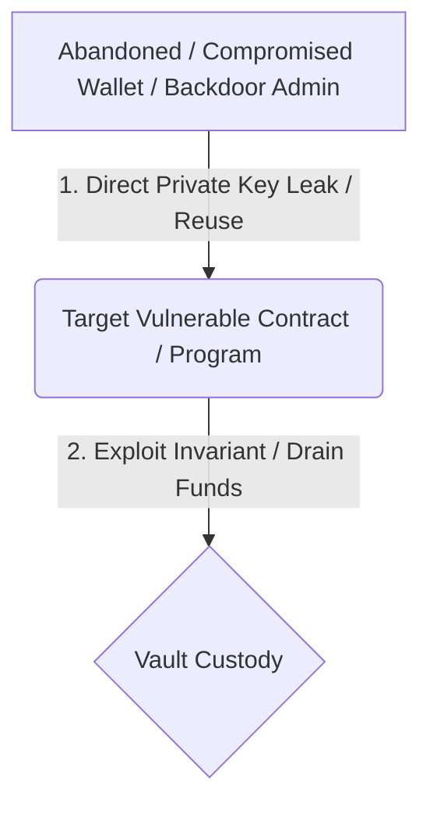

# [Severity] PremiumCVT: <short bug title>

## Summary
<One paragraph. Name the broken invariant.>

## Scope
Program: <program id>
Cluster: <devnet/localnet/mainnet if explicitly allowed>
Instruction(s): <mint_cvt / burn_hvt / claim_rewards / etc.>

## Impact
<Who loses what, who gains what, and why this matters.>

## Preconditions
- <attacker requirements>
- <state requirements>
- <accounts required>

## Reproduction
1. <setup>
2. <transaction or local test>
3. <observed result>

## Expected behavior
<What should have happened.>

## Actual behavior
<What happened instead.>

## Visual Graph (Attack Path)

## Historical Breach Genealogy
- **Direct Breach Risk:** <yes/no - list breached addresses directly involved>
- **Indirect Breach Path:** `Target Address` <--> `Intermediate Relays` <--> `Breached Node` (Total hops: N)
- **Tracing Evidence Logs:** See relational schema indexes and transaction graph mappings for confirmation.

## Evidence
- Logs: `evidence/...`
- Test: `tests/...`
- Transaction signature if allowed and harmless: `<sig>`

## Root cause
<Missing signer check, missing PDA validation, incorrect math, etc.>

## Recommended fix
<Specific constraint, check, invariant test, or accounting correction.>

## Notes on safety
This PoC was performed on <localnet/devnet/read-only mainnet> and did not modify user funds or
third-party state.
